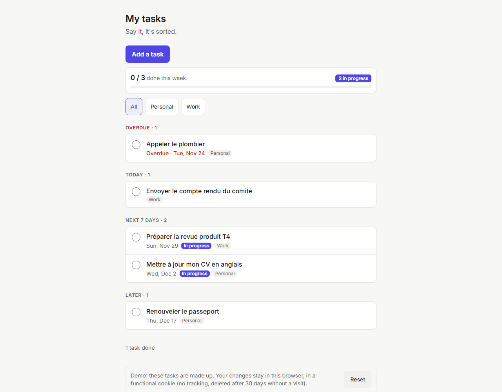
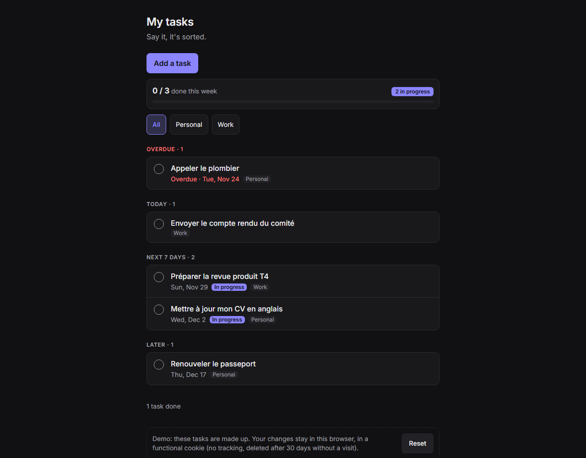

# Smart Board

> **Say it, it's sorted.** A to-do board where you describe a task in one sentence, and an assistant asks
> for whatever is missing (title, description, due date) before filing a complete card.

**[Live demo →](https://smart-board-puce.vercel.app)** · no sign-up, sample data, your changes stay in your browser.



## Why

Quick notes like "call the plumber" or "passport" end up as vague, undated lines that nobody acts on.
Smart Board refuses incomplete tasks: every card has an actionable title, a short description and a due date.
Instead of a form, an assistant fills the gaps by asking one question at a time.

It is a personal side project, built in short evening sessions, to practise building AI-assisted products end to end.

## Features

- **Board grouped by due date**: overdue, today, next 7 days, later.
- **Weekly progress** and **Personal / Work** filters.
- **Add, edit, start and complete tasks** from the app.
- **Capture from Claude Code** with the `/tache` command (see below).
- **Public demo** where each visitor gets their own sandbox, with a Reset button.
- **English and French**, following the browser language. **Light and dark** themes.

<details>
<summary>Dark theme</summary>



</details>

## Capture via Claude Code

The first input channel is not a form: it is a conversation in [Claude Code](https://claude.com/claude-code),
through a project skill ([`.claude/skills/tache/`](.claude/skills/tache/SKILL.md)).
Example session (the skill speaks French; translated and shortened here):

```text
> /tache passport, and call the plumber about the kitchen sink

Claude: Two tasks. A few questions:
  1. Passport — renew or first application? I suggest Fri, Dec 4 as the deadline.
  2. Plumber — when do you need it fixed? I suggest Mon, Nov 30.

> 1. renew, ok  2. this week

Claude: | Category | Title                 | Description                              | Due          |
        | personal | Renew the passport    | Book an appointment at the town hall...  | Fri, Dec 4   |
        | personal | Call the plumber      | Kitchen sink leaks. Ask for a quote...   | Fri, Nov 27  |
        ok?
```

How it works:

1. The skill breaks the request into tasks, turns relative dates ("Friday", "in two weeks") into real ones,
   and flags duplicates or dependencies with existing tasks.
2. It asks **all missing questions in one message**, always with a suggested default.
3. It shows a preview and **writes nothing until you say "ok"**.
4. It writes through a script (`npm run tasks:add`), which validates every task with the same rules as the app
   and rejects the whole batch if one task is incomplete. The board picks the tasks up from `data/tasks.json`.

The same skill also updates tasks: "passport: done", "move the plumber to Monday".
The cost is covered by an existing Claude subscription; an in-app assistant (Claude API) comes later.

## Architecture

```text
src/core/          Pure business logic, no React: Task type, validation, due-date groups,
                   TaskRepository and TaskAssistant interfaces. Reusable by a future mobile app.
src/lib/tasks/     Storage implementations: file (data/tasks.json), demo (per-visitor cookie).
src/lib/assistant/ Assistant implementations: mock today, Claude API later.
src/app/[locale]/  Next.js pages and server actions.
scripts/           CLI used by the /tache skill: add, update and check tasks.
```

Every external dependency sits behind an interface with a free **mock** implementation, chosen by
environment variable. The app runs fully without any API key or paid service.

| Variable        | Values                 | Default |
|-----------------|------------------------|---------|
| `DATA_PROVIDER` | `mock` \| `file`       | `mock`  |
| `LLM_PROVIDER`  | `mock` \| `claude`     | `mock`  |

## Tech stack

- [Next.js 16](https://nextjs.org) (App Router) · TypeScript · [Tailwind CSS 4](https://tailwindcss.com) · [shadcn/ui](https://ui.shadcn.com)
- [next-intl](https://next-intl.dev) for English and French
- [Vitest](https://vitest.dev) for unit tests · GitHub Actions CI · deployed on [Vercel](https://vercel.com)
- [Claude Code](https://claude.com/claude-code) skill for conversational capture

## Run locally

Requires Node.js 20+.

```bash
git clone https://github.com/titou2105/smart-board.git
cd smart-board
npm install
cp .env.example .env.local   # optional: defaults to sample data
npm run dev
```

Open http://localhost:3000.

To use your own tasks, set `DATA_PROVIDER=file` in `.env.local` and copy `data/tasks.example.json`
to `data/tasks.json` (git-ignored).

| Command          | What it does                                    |
|------------------|-------------------------------------------------|
| `npm run dev`    | Start the dev server                            |
| `npm run check`  | Lockfile, type check, lint and tests (run in CI) |
| `npm test`       | Unit tests                                      |
| `npm run build`  | Production build                                |

## Product approach

The project is run like a product, with a vision, milestones, epics and user stories, and one branch and
pull request per story.

- Vision: [`docs/product.md`](docs/product.md) (in French)
- Backlog: [`docs/cockpit/backlog.json`](docs/cockpit/backlog.json)
- Technical decisions: [`docs/decisions.md`](docs/decisions.md)

**Roadmap**: capture via Claude Code ✅ · usable app online (in progress) · cloud storage and in-app assistant ·
first integrations (email, calendar).
